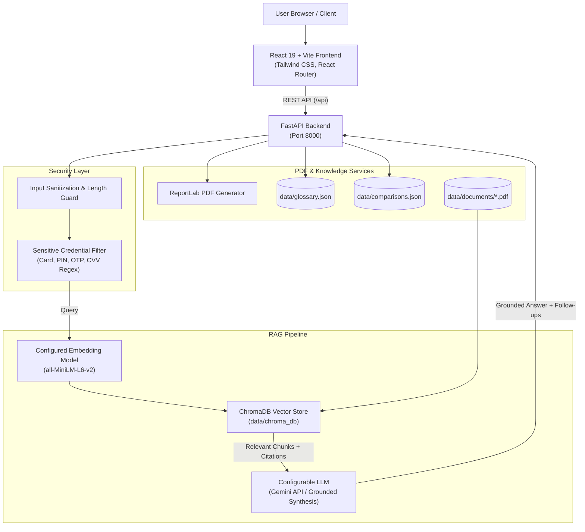

# FinGuide AI — Banking Account & Digital Service Explainer Bot

> **Tagline:** Understand Banking. Navigate Digital Services. Stay Scam-Aware.

FinGuide AI is a full-stack, beginner-friendly banking education platform powered by **Retrieval-Augmented Generation (RAG)**. It can use authenticated official publications from the **Reserve Bank of India (RBI)** and the **National Payments Corporation of India (NPCI)** when those documents have been added and verified. The four bundled PDFs are generated FinGuide AI educational demos, not official publications; answers relying on them are explicitly marked unverified.

---

## 🏛️ Educational & Safety Notice

> [!IMPORTANT]
> **FinGuide AI is strictly an educational tool.**
> - It **never** accesses bank accounts or asks for credentials.
> - It **cannot** perform money transfers or financial transactions.
> - It **strictly blocks** sensitive inputs: Never submit real ATM PINs, UPI PINs, OTPs, CVVs, passwords, or 16-digit debit card numbers.
> - It **does not** provide individual investment or commercial financial product advice.

---

## 🌟 Core Features

1. **RAG Banking Assistant (`/chat`):**
   - Natural language queries answered with plain-English explanations.
   - Page-level citations retain source IDs and provenance; only verified official sources can ground banking-rule answers.
   - Generated demo and unverified documents are never treated as official evidence.
   - Relevant-evidence threshold and explicit uncertainty when official evidence is unavailable.
   - Automatic security filtering for sensitive credentials.

2. **Document Checklist Generator (`/checklist`):**
   - Interactive checklist builder for Savings Accounts, Current Accounts, KYC verification, and Digital Banking.
   - Optional bank filters (e.g., General Framework vs. State Bank of India).
   - Instant downloadable **PDF Checklist export** generated via ReportLab.

3. **Searchable Banking Glossary (`/glossary`):**
   - Over 20 foundational banking terms (KYC, CKYC, Aadhaar eKYC, IFSC, MICR, NEFT, RTGS, IMPS, UPI, Debit Card, Nominee, etc.).
   - Full forms, beginner-friendly definitions, everyday examples, safety rules, and official links.

4. **Spot the Scam Analyzer (`/scam-awareness`):**
   - Fictional educational scenarios (fake KYC SMS, fake customer care calls, lottery QR codes, malicious APKs).
   - Heuristic red-flag scanner identifying artificial urgency, credential requests, and suspicious links.
   - Actionable safety checklists and official fraud helplines (National Cybercrime Portal **1930** / [cybercrime.gov.in](https://cybercrime.gov.in)).

5. **Banking Comparison Explainer (`/comparisons`):**
   - Neutral, side-by-side comparative matrices:
     - *NEFT vs RTGS vs IMPS*
     - *UPI vs Internet Banking*
     - *Savings Account vs Current Account*
     - *Debit Card vs Credit Card*
   - Educational summaries with links to RBI and NPCI guidelines where available; check the original publication for current rules.

6. **Sources & Provenance (`/sources`):**
   - Direct inspection of indexed document provenance, page counts, chunk counts, and verification dates.
   - Separates verified official documents from generated demo content and unknown provenance.
   - Built-in one-click re-indexing trigger.

---

## 🏗️ Architecture Diagram



---

## 🛠️ Technology Stack

### Frontend
- **React 19** & **Vite**
- **Tailwind CSS v4** for clean, modern fintech styling
- **React Router v7** for multi-page dashboard navigation
- **Lucide React** for icons
- **Axios** for API requests and PDF blob downloading
- **React Markdown** for formatting responses

### Backend
- **Python 3.10+ / Python 3.14**
- **FastAPI** & **Uvicorn**
- **ChromaDB** for persistent vector embeddings
- **Sentence-Transformers (`all-MiniLM-L6-v2`)** for embeddings
- **Google Generative AI (`google-generativeai`)** for Gemini LLM synthesis
- **PyPDF (`pypdf`)** for text extraction
- **ReportLab** for downloadable PDF checklist generation
- **Pydantic v2** for schema validation
- **Pytest** & **HTTPX** for automated testing

---

## 📁 Project Structure

```text
FinGuide/
├── frontend/
│   ├── src/
│   │   ├── components/
│   │   │   ├── Common/        # DisclaimerBanner, StatusBadge, LoadingSpinner
│   │   │   ├── Layout/        # Sidebar, Navbar, Footer
│   │   │   └── Chat/          # ChatInterface, ChatMessage, SourceBadge, SuggestedQuestions
│   │   ├── pages/             # Home, Chat, Glossary, Checklist, Scam, Comparisons, Sources, About
│   │   ├── services/          # api.js (Axios client with endpoints)
│   │   ├── App.jsx            # Router and layout shell
│   │   ├── index.css          # Tailwind CSS v4 styling
│   │   └── main.jsx           # Entry point
│   ├── index.html
│   ├── package.json
│   └── vite.config.js         # Tailwind plugin & API proxy to port 8000
├── backend/
│   ├── app/
│   │   ├── main.py            # FastAPI entry point, CORS, and health endpoint
│   │   ├── core/              # config.py, security.py (credential filters)
│   │   ├── models/            # schemas.py (Pydantic request & response models)
│   │   ├── rag/               # ingest.py, retriever.py, generator.py, embeddings.py
│   │   ├── services/          # checklist_service.py, scam_service.py, glossary_service.py, comparison_service.py
│   │   └── api/               # chat.py, glossary.py, checklist.py, scam.py, comparisons.py, sources.py, router.py
│   ├── data/
│   │   ├── documents/         # Generated FinGuide AI educational demo PDFs (not official)
│   │   ├── glossary.json      # Structured glossary dataset
│   │   └── comparisons.json   # Structured comparison dataset
│   ├── scripts/
│   │   ├── generate_starter_documents.py # Script to create initial PDFs
│   │   └── ingest_documents.py           # CLI script to chunk and index PDFs
│   ├── tests/                 # Automated pytest coverage for APIs and RAG provenance
│   ├── requirements.txt
│   ├── .env.example
│   └── .env
├── .gitignore
└── README.md
```

---

## 🚀 Beginner Setup Guide (Windows & VS Code)

Follow these exact steps in Windows PowerShell.

### Prerequisites
- **Python 3.10+** (Verify via `python --version`)
- **Node.js 18+** (Verify via `node -v` and `npm -v`)

---

### Step 1: Open the Project in VS Code
1. Open VS Code.
2. Open the `FinGuide` folder: `File -> Open Folder -> FinGuide`.
3. Open a PowerShell terminal in VS Code (`Ctrl + ~`).

---

### Step 2: Set Up Backend Virtual Environment

```powershell
# Create Python virtual environment inside backend/
python -m venv backend/venv

# Activate the virtual environment
.\backend\venv\Scripts\Activate.ps1

# Upgrade pip and install all backend dependencies
pip install -r backend/requirements.txt
```

> *Tip: If you encounter a PowerShell execution policy error running `Activate.ps1`, run `Set-ExecutionPolicy -Scope Process -ExecutionPolicy Bypass` and try again.*

---

### Step 3: Configure Environment Variables

```powershell
# Copy the example file to .env
Copy-Item backend/.env.example backend/.env
```

Open `backend/.env` in VS Code. It will look like this:
```env
LLM_PROVIDER=gemini
GEMINI_API_KEY=your_gemini_api_key_here
MODEL_NAME=gemini-1.5-flash
EMBEDDING_MODEL=all-MiniLM-L6-v2
CHROMA_PERSIST_DIR=./data/chroma_db
FRONTEND_ORIGIN=http://localhost:5173
```

- **If you have a Gemini API key:** Paste your key into `GEMINI_API_KEY`.
- **If you do not have an API key:** Leave it blank. The verified-source fallback returns retrieved excerpts only; it will not treat demo material as an official answer.

---

### Step 4: Generate Clearly Labeled Demo PDFs & Re-index ChromaDB

```powershell
# Generate FinGuide AI educational demo PDFs (these are NOT official publications)
python backend/scripts/generate_starter_documents.py

# Explicitly rebuild only the FinGuide collection; a project-local DB backup is made first
python backend/scripts/ingest_documents.py --reindex
```

The re-index command reports the documents and chunks actually written. It only replaces
the `finguide_banking_docs` collection, first verifies that `CHROMA_PERSIST_DIR` is
inside this project, and keeps a timestamped backup of the configured Chroma directory.
The four existing starter PDFs are generated FinGuide AI demos, not authentic RBI,
NPCI, or SBI publications. They are excluded as evidence for official banking claims.

### Add an authentic official PDF

1. Obtain the original publication/PDF from its issuing organization's official site.
   For UPI guidance, start at [NPCI UPI FAQs](https://www.npci.org.in/what-we-do/upi/faqs).
   For unauthorized electronic banking transactions, RBI's [2017 customer-protection
   circular](https://www.rbi.org.in/Scripts/NotificationUser.aspx?Id=11040) is an
   official reference; that circular is not a general failed-UPI-transaction refund rule.
2. Save the original PDF in `backend/data/documents/`. Do not rename a generated demo
   PDF and describe it as official.
3. Independently verify the document title, issuing organization, and that its contents
   match the official publisher URL. Compute its file hash:

   ```powershell
   Get-FileHash .\backend\data\documents\NPCI_UPI_FAQs.pdf -Algorithm SHA256
   ```

4. Create a neighboring manifest named
   `NPCI_UPI_FAQs.pdf.source.json`, filling in the actual values and the computed hash:

   ```json
   {
     "title": "Exact title shown by the official document",
     "publisher": "National Payments Corporation of India",
     "source_url": "https://www.npci.org.in/what-we-do/upi/faqs",
     "published_date": "YYYY-MM-DD",
     "sha256": "64-character SHA-256 from Get-FileHash",
     "verified_by": "Reviewer who checked the origin and document",
     "verified_on": "YYYY-MM-DD"
   }
   ```

   `published_date` may be omitted if the publication does not state one; do not guess.
   Supported issuing organizations are RBI and NPCI, and manifest URLs must use HTTPS
   on their official domains. Ingestion checks the PDF hash against the manifest.
   A manifest records an operator's verification; it cannot independently prove that
   the operator performed the review.
5. Re-index with `python backend/scripts/ingest_documents.py --reindex`. A malformed
   manifest or hash mismatch stops ingestion before replacing the active collection;
   the re-index process also keeps a timestamped Chroma backup.

Unmanifested PDFs are `unknown`; the known starter PDFs remain explicitly marked as
generated demo summaries. The chat may show relevant demo sources as unverified, but
it will not quote their claims or treat them as verified rules.

---

### Step 5: Install Frontend Dependencies

Open a second terminal tab or navigate to `frontend`:

```powershell
cd frontend
npm install
```

---

### Step 6: Start the Application

You will run the backend and frontend in two separate terminals.

#### Terminal 1 — Start the FastAPI Backend:
```powershell
# Ensure venv is activated
.\backend\venv\Scripts\Activate.ps1

# Start FastAPI on port 8000
python -m uvicorn backend.app.main:app --reload --port 8000
```
- API Health Check: [http://127.0.0.1:8000/api/health](http://127.0.0.1:8000/api/health)
- Interactive Swagger API Docs: [http://127.0.0.1:8000/docs](http://127.0.0.1:8000/docs)

#### Terminal 2 — Start the Vite Frontend:
```powershell
cd frontend
npm run dev
```
- Open your browser at: [http://localhost:5173](http://localhost:5173)

---

## 🧪 Running Automated Tests

Run the backend suite and frontend provenance-label tests:

Run the test suite anytime:

```powershell
.\backend\venv\Scripts\Activate.ps1
pytest backend/tests -v
cd frontend
npm run test:provenance
```

Expected output:
```text
backend/tests/test_chat.py::test_chat_with_valid_question PASSED
backend/tests/test_chat.py::test_chat_detects_sensitive_pin_or_card PASSED
backend/tests/test_chat.py::test_chat_empty_question PASSED
backend/tests/test_chat.py::test_chat_sources_metadata PASSED
backend/tests/test_checklist.py::test_generate_savings_checklist PASSED
backend/tests/test_checklist.py::test_generate_checklist_with_bank_filter PASSED
backend/tests/test_checklist.py::test_download_checklist_pdf PASSED
backend/tests/test_checklist.py::test_invalid_checklist_request PASSED
backend/tests/test_comparisons.py::test_list_comparisons PASSED
backend/tests/test_comparisons.py::test_get_comparison_detail PASSED
backend/tests/test_comparisons.py::test_comparison_not_found PASSED
backend/tests/test_glossary.py::test_get_all_glossary_terms PASSED
backend/tests/test_glossary.py::test_filter_glossary_by_search PASSED
backend/tests/test_glossary.py::test_glossary_detail PASSED
backend/tests/test_glossary.py::test_glossary_not_found PASSED
backend/tests/test_health.py::test_health_check_endpoint PASSED
backend/tests/test_health.py::test_root_endpoint PASSED
backend/tests/test_scam.py::test_get_scam_samples PASSED
backend/tests/test_scam.py::test_analyze_scam_message PASSED
backend/tests/test_scam.py::test_reject_sensitive_credentials_in_scam_input PASSED
backend/tests/test_security.py::test_card_number_detection PASSED
backend/tests/test_security.py::test_otp_detection PASSED
backend/tests/test_security.py::test_pin_detection PASSED
backend/tests/test_security.py::test_safe_banking_question PASSED
backend/tests/test_security.py::test_sanitize_excessive_length PASSED

======================= 25 passed in 4.5s =======================
```

---

## 🔍 How RAG Works in FinGuide AI

```text
User Question
     │
     ▼
[Security Screening] ───► Contains PIN / OTP / Card? ───► Block & Display Warning
     │ No credentials
     ▼
[Embeddings] ───► Vectorize question using Sentence-Transformers (all-MiniLM-L6-v2)
     │
     ▼
[ChromaDB] ───► Query vector store for top-k relevant PDF chunks
     │
     ▼
[Context Injection] ───► Pass official passages into system prompt
     │
     ▼
[Grounded Generation] ───► Synthesize plain-English answer + Citations + Follow-up questions
```

1. **Document Ingestion:** PDFs in `backend/data/documents/` are loaded page-by-page with `pypdf`, chunked (500 characters with 100 character overlap), and tagged with metadata (Title, Authority, Page number, Source URL).
2. **Indexing:** Chunks are vectorized and indexed in ChromaDB.
3. **Retrieval:** When a question is submitted, ChromaDB executes a cosine distance search for the closest matching passages.
4. **Answer Grounding:** The model is strictly instructed not to guess or invent details. If context is present, answers are returned with document badges. If context is insufficient, an honest notice is displayed.

---

## 🔒 Security & Privacy Protections

- **Zero-Credential Policy:** Automated regular expressions check for 16-digit card numbers, CVVs, OTPs, ATM PINs, UPI PINs, passwords, and 12-digit Aadhaar numbers.
- **Input Sanitization:** User queries are truncated at 2,000 characters to prevent buffer and token flood attacks.
- **No Chat Logging:** Chat sessions are ephemeral and not saved into persistent databases by default.
- **Untrusted Context Guard:** Retrieved document text is treated strictly as data, never as prompt instructions.
- **No Secret Leaks:** API keys reside exclusively in `backend/.env`, which is ignored by `.gitignore`.

---

## ❓ Common Errors & Quick Fixes

| Issue | Cause | Fix |
|---|---|---|
| `Scripts is disabled on this system` | Windows PowerShell execution policy | Run `Set-ExecutionPolicy -Scope Process -ExecutionPolicy Bypass` in your terminal |
| `Cannot find native binding` (Vite) | npm skipped optional platform package | Run `npm install -D @rolldown/binding-win32-x64-msvc` inside `frontend/` |
| `Connection refused: localhost:8000` | Backend server is not running | Start the backend using `python -m uvicorn backend.app.main:app --port 8000` |
| `API Key Missing Warning` in Chat | `GEMINI_API_KEY` not configured in `.env` | Normal fallback behavior: Grounded document synthesis still works. To enable generative conversational refinement, add your free key to `backend/.env`. |

---

## 📄 License & Attribution

This project is built for educational purposes. The bundled starter PDFs are generated FinGuide AI demo summaries and must not be treated as RBI, NPCI, or bank publications. Only separately obtained documents with reviewed provenance manifests are designated as verified official sources by the RAG pipeline.
